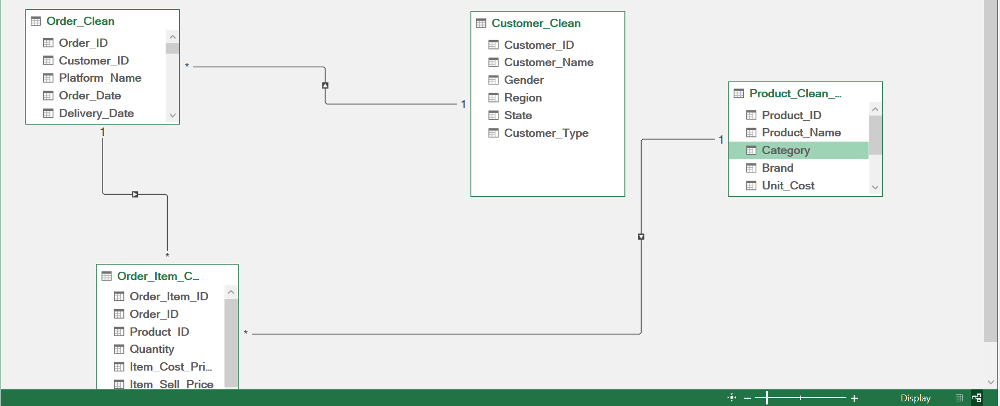
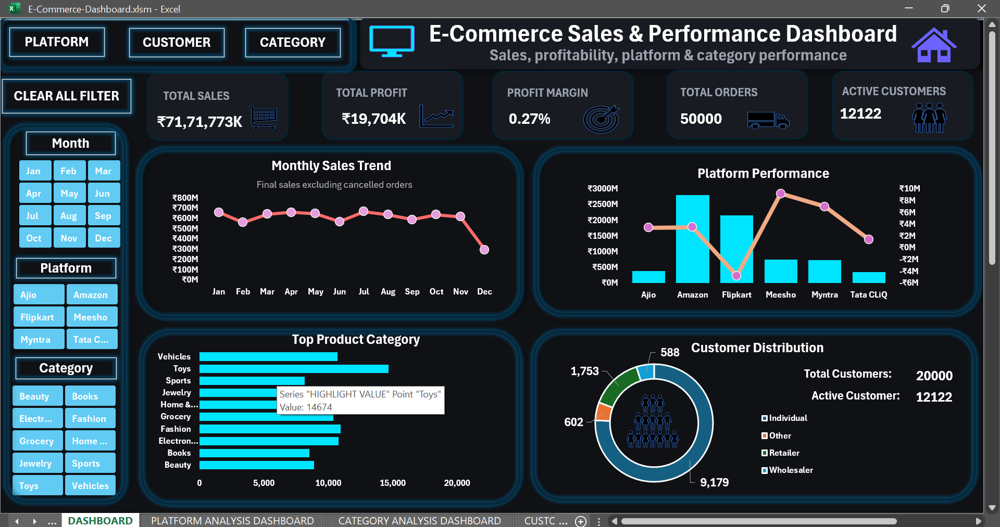
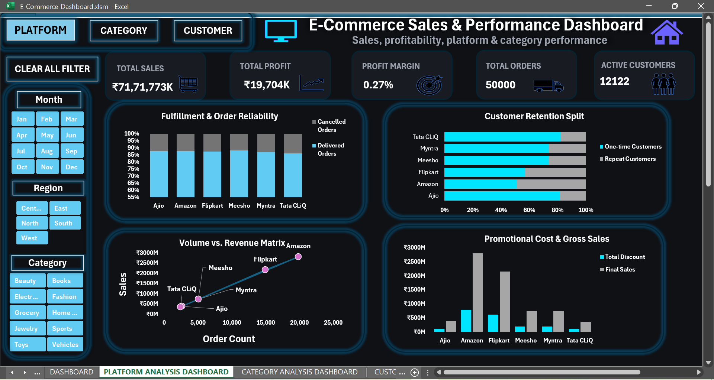
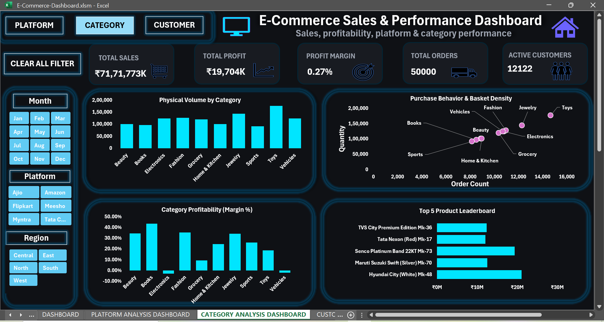
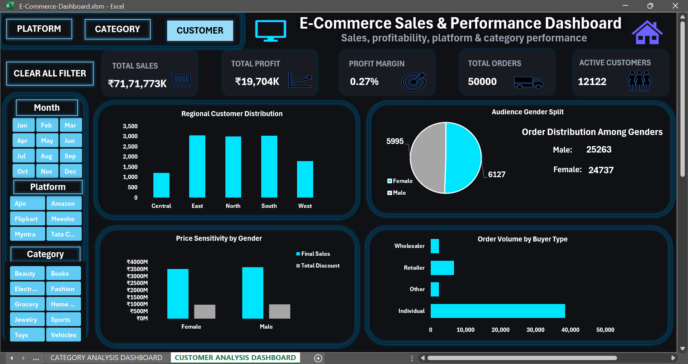

# E-Commerce Sales & Performance Dashboard

An interactive Excel-based business intelligence project for analyzing e-commerce sales, profitability, platform performance, product categories, and customer behavior.

> **Data disclaimer:** This project uses synthetic e-commerce data for educational, analytical, and portfolio purposes. The figures and patterns shown do not represent the verified performance of a real company.

## Table of Contents

1. [Project Overview](#1-project-overview)
2. [Business Questions](#2-business-questions)
3. [Dataset and Data Model](#3-dataset-and-data-model)
4. [DAX Measures and Business Logic](#4-dax-measures-and-business-logic)
5. [Dashboard Pages](#5-dashboard-pages)
6. [Interactive Features](#6-interactive-features)
7. [Key Analytical Observations](#7-key-analytical-observations)
8. [Tools and Techniques](#8-tools-and-techniques)
9. [How to Use the Workbook](#9-how-to-use-the-workbook)
10. [Limitations](#10-limitations)
11. [Repository Structure](#11-repository-structure)

---

## 1. Project Overview

The E-Commerce Sales & Performance Dashboard is an interactive business intelligence project developed in Microsoft Excel. It transforms structured e-commerce data into connected analytical views for exploring financial performance, platform comparisons, product-category profitability, and customer behavior.

The workbook combines Power Pivot, a relational data model, DAX measures, PivotTables, PivotCharts, slicers, and dashboard navigation controls.

It contains four dashboard pages:

- **Main Dashboard:** Overall business performance and key performance indicators.
- **Platform Analysis Dashboard:** Platform-level profitability and order outcomes.
- **Category Analysis Dashboard:** Sales and profitability comparisons across product categories.
- **Customer Analysis Dashboard:** Customer distribution and purchasing behavior.

### Project objectives

- Monitor sales, profit, orders, profit margin, and customer counts.
- Compare financial and operational performance across platforms.
- Identify differences in category-level profitability.
- Explore customer distribution and purchasing patterns.
- Build an interactive, multi-page reporting experience.
- Demonstrate analytical thinking alongside Excel and DAX capabilities.

The design follows a simple principle: a useful dashboard should not merely display numbers. Its metrics, visualizations, and filter behavior should help users investigate meaningful business questions.

## 2. Business Questions

| Analytical area | Questions explored |
|---|---|
| Overall performance | What sales value and profit are recorded under the project's reporting rules? |
| Order activity | How many distinct orders are recorded? |
| Profitability | How does profit compare with sales, and what is the profit margin? |
| Monthly performance | How does sales activity change over time? |
| Platform performance | How do platforms compare in profitability and order outcomes? |
| Category performance | Which categories contribute positively or negatively to measured profit? |
| Order status | How many orders are delivered or cancelled? |
| Customer distribution | How are customers distributed across regions and genders? |
| Purchasing behavior | How do one-time and repeat customers compare? |
| Discounts | How do sales and discounts vary across customer groups? |

These analyses help identify patterns for further investigation. They do not independently establish the causes of those patterns.

## 3. Dataset and Data Model

### Dataset overview

The workbook uses synthetic data organized into four related tables.

| Table | Approximate rows | Purpose |
|---|---:|---|
| `Customer` | 20,000 | Customer-related attributes |
| `Order_Clean` | 50,000 | Order information, status, and financial fields |
| `Product_Clean` | 5,000 | Product-related attributes |
| `Order Items` | 115,000 | Individual product lines associated with orders |

The tables represent different levels of detail. A customer can place multiple orders, an order can contain multiple item rows, and a product can appear in many order-item records.

Keeping these entities separate helps preserve the distinction between customers, orders, products, and individual product lines.

### Data model relationships

The workbook uses Power Pivot relationships to connect the tables.

```text
Customer
   1
   |
   *
Order_Clean
   1
   |
   *
Order Items
   *
   |
   1
Product_Clean
```

The relationships are:

- `Customer[Customer_ID]` → `Order_Clean[Customer_ID]`
- `Order_Clean[Order_ID]` → `'Order Items'[Order_ID]`
- `Product_Clean[Product_ID]` → `'Order Items'[Product_ID]`

The model allows measures to analyze data across related tables while maintaining the distinction between order-level and item-level calculations.

### Data model diagram



## 4. DAX Measures and Business Logic

DAX measures define the calculations used throughout the dashboards. The financial measures form the foundation for the project's sales and profitability analysis.

### 4.1 Order Cost

```dax
Order_Cost =
SUM('Order Items'[Item Value])
```

Sums the item values used as the project's order-cost basis.

### 4.2 Order Sell Value

```dax
Order_Sell_Value =
SUM('Order Items'[Item Selling Value])
```

Sums the selling value recorded for order items.

### 4.3 Total Discount

```dax
Total Discount =
SUMX(
    Order_Clean,
    [Order_Sell_Value] * Order_Clean[Discount_%]
)
```

Calculates discount amounts by multiplying the evaluated selling value by the discount percentage for each order row.

### 4.4 Platform Fee

```dax
Platform Fee =
SUM(Order_Clean[Platform_Fee])
```

Sums the platform fees recorded in the order table.

### 4.5 Final Sale Value

```dax
Final_Sale_Value =
[Order_Sell_Value]
    - [Total Discount]
    + [Platform Fee]
```

Calculates adjusted sale value by subtracting discounts and adding platform fees.

### 4.6 Final Sales

```dax
Final Sales =
CALCULATE(
    [Final_Sale_Value],
    Order_Clean[Order Status] <> "Cancelled"
)
```

Calculates Final Sales while excluding cancelled orders.

**Reporting rule:** Delivered, Pending, and Out for Delivery orders remain included. Therefore, Final Sales represents the project's defined sales measure, not necessarily cash collected or completed-delivery revenue.

### 4.7 Final Order Cost

```dax
Final Order Cost =
CALCULATE(
    [Order_Cost],
    Order_Clean[Order Status] <> "Cancelled"
)
```

Applies the same cancelled-order exclusion to the cost calculation, keeping the sales and cost populations consistent.

### 4.8 Profit

```dax
Profit =
[Final Sales] - [Final Order Cost]
```

Calculates profit as Final Sales minus Final Order Cost.

### 4.9 Profit Margin %

```dax
Profit Margin % =
DIVIDE(
    [Profit],
    [Final Sales]
)
```

Calculates profit as a proportion of Final Sales. The measure should be formatted as a percentage in Excel.

### 4.10 Customer Order Count

```dax
Customer Order Count =
DISTINCTCOUNT(Order_Clean[Order_ID])
```

Counts distinct orders in the current filter context rather than counting individual order-item rows.

### 4.11 One-time Customers

```dax
One-time Customers =
COUNTROWS(
    FILTER(
        VALUES(Customer[Customer_ID]),
        [Customer Order Count] = 1
    )
)
```

Counts customers whose evaluated order count is exactly one.

### 4.12 Repeat Customers

```dax
Repeat Customers =
COUNTROWS(
    FILTER(
        VALUES(Customer[Customer_ID]),
        [Customer Order Count] > 1
    )
)
```

Counts customers whose evaluated order count exceeds one.

Both customer classifications depend on the active filter context. They are useful for exploratory purchasing analysis but are not equivalent to formal customer-retention metrics.

### 4.13 Category Order Count

```dax
Category Order Count =
CALCULATE(
    DISTINCTCOUNT(Order_Clean[Order_ID]),
    CROSSFILTER(
        Order_Clean[Order_ID],
        'Order Items'[Order_ID],
        BOTH
    )
)
```

Counts distinct orders associated with a selected category by temporarily enabling bidirectional filtering between the order and order-item tables for this calculation.

### 4.14 Category Customer Count

```dax
Category Customer Count =
CALCULATE(
    DISTINCTCOUNT(Order_Clean[Customer_ID]),
    CROSSFILTER(
        Order_Clean[Order_ID],
        'Order Items'[Order_ID],
        BOTH
    )
)
```

Counts distinct customers associated with orders containing products from the selected category.

Orders and customers can appear in multiple categories, so category-level distinct counts are not necessarily additive to overall totals.

### 4.15 Delivered Orders

```dax
Delivered Orders =
CALCULATE(
    DISTINCTCOUNT(Order_Clean[Order_ID]),
    Order_Clean[Order Status] = "Delivered"
)
```

Counts distinct orders recorded as delivered.

### 4.16 Cancelled Orders

```dax
Cancelled Orders =
CALCULATE(
    DISTINCTCOUNT(Order_Clean[Order_ID]),
    Order_Clean[Order Status] = "Cancelled"
)
```

Counts distinct cancelled orders. Although cancelled orders are excluded from Final Sales, cancellation activity remains available for operational analysis.

### Measure calculation flow

```text
Order Sell Value
       |
       +---- Total Discount
       |
       +---- Platform Fee
                |
                v
        Final Sale Value
                |
        Exclude Cancelled
                |
                v
           Final Sales

Order Cost
    |
Exclude Cancelled
    |
    v
Final Order Cost

Final Sales - Final Order Cost
                |
                v
              Profit
                |
        Profit / Final Sales
                |
                v
         Profit Margin %
```

**Financial definition:** These measures follow the project's business logic. Profit represents Final Sales minus Final Order Cost; it should not be interpreted as complete net profit unless all relevant operating expenses are included.

## 5. Dashboard Pages

### 5.1 Main Dashboard

The Main Dashboard provides an executive-level overview of business performance.

It contains five headline KPI cards:

- Total Sales
- Total Profit
- Total Orders
- Profit Margin
- Customers

Supporting visualizations include monthly sales trends, platform comparisons, category comparisons, and a customer overview.

The purpose is to establish the overall performance picture before moving into more detailed analysis.



### 5.2 Platform Analysis Dashboard

This dashboard examines differences across selling platforms through:

- Platform-level profitability.
- Delivered versus cancelled orders.
- One-time versus repeat customers.
- Selected-platform KPI comparisons.

Sales contribution alone does not determine profitability. Comparing sales, profit, and order outcomes provides a broader view of platform performance.

Some comparison charts intentionally retain all platforms even when a Platform filter is selected. This allows the viewer to examine one platform through the KPI cards while preserving the wider comparison in the relevant charts.



### 5.3 Category Analysis Dashboard

This dashboard compares product categories using sales, profit, and related order and customer measures.

Category-level profitability helps identify differences that may be hidden by overall totals. The `Category Order Count` and `Category Customer Count` measures use `CROSSFILTER` to allow category selections to affect the relevant order-level calculations.

The results highlight differences under the project's defined financial logic and synthetic dataset.



### 5.4 Customer Analysis Dashboard

The Customer Analysis Dashboard explores customer distribution and purchasing behavior through:

- Region-wise customer distribution.
- Gender distribution.
- Gender-wise sales and discount comparisons.
- Customer type and order count.
- One-time and repeat-customer analysis.

These views provide descriptive insights into the customer records represented in the dataset. They do not establish the reasons behind differences between customer groups.



## 6. Interactive Features

The workbook combines analytical views with interactive controls.

### Slicers

Slicers allow users to filter supported dashboard views by dimensions such as platform, category, region, and month.

### Clear All Filters

The Clear All Filters control returns the report to its default filter state without requiring users to clear every slicer individually.

### Dashboard navigation

Navigation controls connect the Main Dashboard with the Platform, Category, and Customer Analysis pages.

### Full-screen viewing

The full-screen control provides a more focused dashboard viewing experience.

### Chart highlighting

Helper ranges support chart-highlighting behavior in selected monthly and category analyses, allowing particular data points or periods to receive greater visual emphasis.

### Filter logic

Filter behavior follows the purpose of each visualization. For example, a KPI showing a selected platform should respond to the Platform filter, while a chart designed to compare all platforms may intentionally ignore that filter.

This distinction helps preserve the analytical meaning of the visualizations.

## 7. Key Analytical Observations

The following are recorded project results from the synthetic dataset. They demonstrate how the dashboard can be used to examine differences in performance.

### 7.1 Overall financial performance

| Metric | Recorded result |
|---|---:|
| Final Sales | Approximately ₹717.18 crore |
| Final Order Cost | Approximately ₹715.21 crore |
| Profit | Approximately ₹1.97 crore |
| Profit Margin | Approximately 0.27% |

The recorded sales value is large relative to the measured profit. This illustrates why the dashboard considers profitability and margin alongside sales volume.

### 7.2 Platform profitability

| Platform | Recorded profit |
|---|---:|
| Meesho | Approximately ₹91.93 lakh |
| Myntra | Approximately ₹69.79 lakh |
| Amazon | Approximately ₹34.74 lakh |
| Ajio | Approximately ₹34.20 lakh |
| Tata CLiQ | Approximately ₹14.32 lakh |
| Flipkart | Approximately −₹47.95 lakh |

The figures demonstrate how profitability can differ between platforms under the project's cost and sales definitions.

### 7.3 Category profitability

| Category | Recorded profit |
|---|---:|
| Jewelry | Approximately ₹14.30 crore |
| Fashion | Approximately ₹1.45 crore |
| Beauty | Approximately ₹1.13 crore |
| Electronics | Approximately −₹1.32 crore |
| Vehicles | Approximately −₹13.92 crore |

These differences illustrate the importance of examining category-level profitability instead of relying only on overall sales.

### 7.4 Order-status distribution

| Order status | Recorded orders |
|---|---:|
| Delivered | 35,033 |
| Cancelled | 5,080 |
| Pending | 4,970 |
| Out for Delivery | 4,917 |

This analysis separates operational order outcomes from the financial reporting rule that excludes cancelled orders from Final Sales.

### 7.5 Customer classification

| Metric | Recorded customers |
|---|---:|
| One-time customers | 4,211 |
| Repeat customers | 7,911 |
| Total represented by these groups | 12,122 |

These figures illustrate the customer classification measures based on evaluated order counts.

### 7.6 Understanding the sales measures

The recorded `Final_Sale_Value` total in supporting PivotTables is approximately ₹799.41 crore, compared with approximately ₹717.18 crore for `Final Sales`.

The difference reflects the reporting logic: `Final_Sale_Value` does not independently exclude cancelled orders, while `Final Sales` applies that exclusion.

All figures in this section represent recorded project calculations rather than verified real-world business performance.

## 8. Tools and Techniques

- **Microsoft Excel:** Workbook development, charts, PivotTables, slicers, and dashboard layout.
- **Power Pivot:** Data model and table relationships.
- **DAX:** Reusable financial, order, category, and customer measures.
- **PivotTables and PivotCharts:** Data aggregation and visualization.
- **Slicers:** Interactive filtering.
- **XLOOKUP:** Spreadsheet lookup tasks where applicable.
- **Helper ranges:** Chart-highlighting behavior.

## 9. How to Use the Workbook

1. Open `E-Commerce-Dashboard.xlsm` in desktop Microsoft Excel with support for the workbook's Data Model and Power Pivot features.
2. Start with the Main Dashboard to review the headline KPIs.
3. Use the slicers to explore the supported dimensions.
4. Navigate to the Platform, Category, and Customer Analysis pages for more detailed views.
5. Use Clear All Filters to return to the default filter state.
6. Use the full-screen control for a more focused viewing experience.

If the source data is updated, refresh the relevant data model and PivotTables in Excel.

## 10. Limitations

- **Synthetic data:** The results are for educational and portfolio purposes and do not represent verified company performance.
- **Defined financial logic:** Final Sales, Profit, and Profit Margin follow the project's formulas and may differ from official accounting metrics.
- **Profit scope:** Profit is calculated as Final Sales minus Final Order Cost; other operating expenses are not necessarily included.
- **Filter context:** Customer classifications and category-level counts depend on active filters and relationship behavior.
- **Non-additive category counts:** Orders and customers may appear in multiple categories, so category-level distinct counts may not sum to overall totals.
- **Descriptive analysis:** The dashboard identifies patterns and differences but does not establish causation or provide predictive forecasts.

## 11. Repository Structure

```text
E-Commerce-Sales-Performance-Dashboard/
├── README.md
├── E-Commerce-Dashboard.xlsm
├── screenshots/
│   ├── main-dashboard.png
│   ├── platform-analysis.png
│   ├── category-analysis.png
│   └── customer-analysis.png
└── docs/
    └── data-model.png
```

## Conclusion

The E-Commerce Sales & Performance Dashboard demonstrates how Microsoft Excel can be used to build a connected, multi-page business intelligence solution.

By combining a relational data model, DAX measures, PivotTables, charts, slicers, and dashboard navigation, the project explores financial performance, platform comparisons, category profitability, and customer behavior.

The project highlights that effective analytics depends not only on visual design, but also on clear metric definitions, appropriate data relationships, and filter behavior that matches the business question.

**This project is a portfolio demonstration of Excel-based business intelligence and analytical problem-solving using synthetic e-commerce data.**
